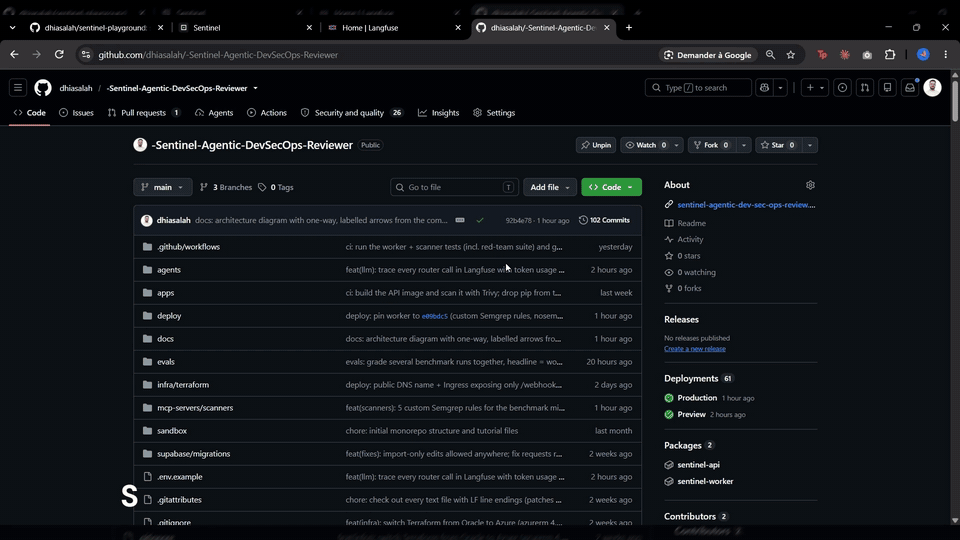
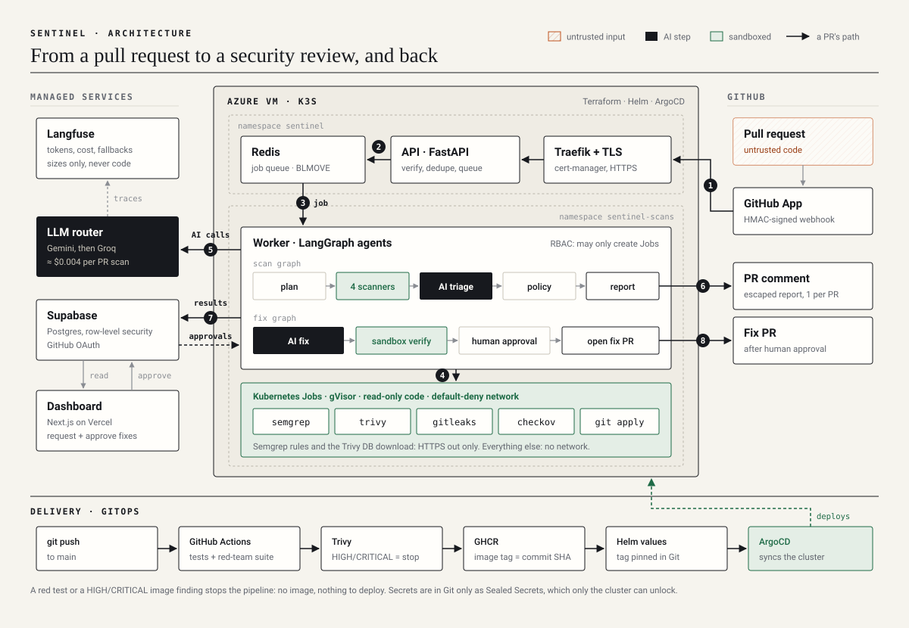
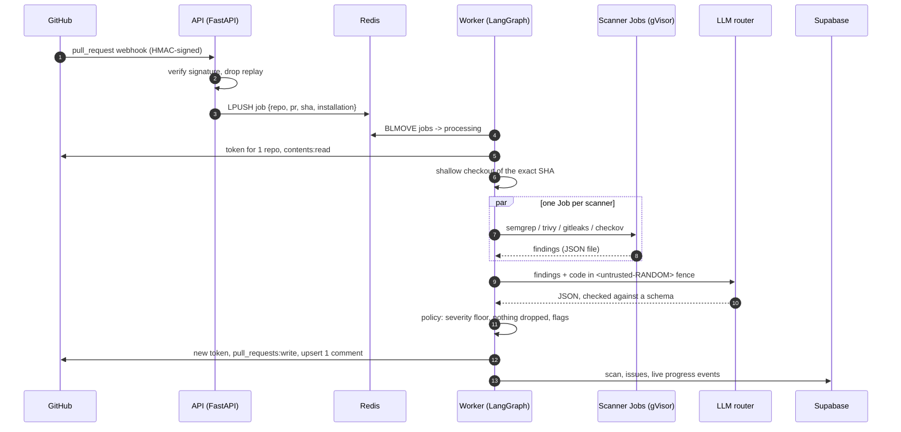
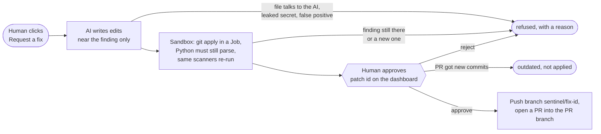
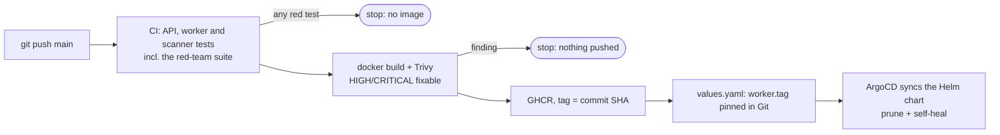

# Sentinel

Sentinel is a GitHub App that reviews pull requests for security problems. Four scanners find the issues, an
LLM explains and ranks them, and the result is posted on the PR. For an issue it can fix, it writes a patch,
checks the patch in a sandbox and waits for a human to approve it before it opens a fix PR.

The interesting part is not that an LLM reads code. It's that the LLM reads **code written by strangers**, so it
has to be treated as something an attacker can talk to. Most of the design follows from that.



| Measured | Result |
|---|---|
| Benchmark: 15 planted vulnerabilities, 4 safe look-alikes | **15/15 found in 3 runs out of 3, 0/4 false alarms** (Semgrep's public rules alone: 7/15) |
| Red-team: 10 prompt-injection attacks, against an AI that fully obeys the attacker | **guardrails held 10/10** · injection detector caught 6/10, false alarm on 3 of 4 safe files |
| Cost of one PR scan (Langfuse) | **≈ $0.004** of LLM tokens |
| Tests | 206 worker (+ 7 documented gaps), 38 scanner, 13 API. All of them gate the image build in CI |

---

## Architecture



The numbers follow one PR:

1. GitHub sends a signed `pull_request` webhook. Traefik terminates TLS (cert-manager, Let's Encrypt).
2. The API checks the HMAC signature on the raw body, drops replays (body hash kept 24 h in Redis) and pushes a
   small job. It never touches the code.
3. The worker takes the job with `BLMOVE`, so a crash can't lose it. A job that fails goes to a dead-letter list.
4. The scan graph (LangGraph) picks the scanners that match the files, then runs each one as its **own
   Kubernetes Job**.
5. The findings go to the LLM through a router: Gemini first, Groq when Gemini is down or answers badly.
6. A policy layer checks the AI's answer, then **one** comment is posted or updated on the PR.
7. Results go to Supabase. The dashboard (Next.js on Vercel) reads them through row-level security and is where
   a human asks for a fix, then approves or rejects it.
8. An approved patch becomes a PR into the PR's own branch. Nothing is ever merged by Sentinel.

### A pull request, step by step



### A fix, step by step



The fix graph pauses at the approval step with a LangGraph `interrupt`, and its state is checkpointed in SQLite
on a volume, so a fix can wait for days and survive a restart. The approval names the **patch id**. If the PR
received new commits since the patch was made, the approval no longer matches the code and the fix is marked
outdated instead of applied.

### From a commit to the cluster



Images are never tagged `latest`. A tag is a commit SHA from a green run, written in Git, so every deploy is
a reviewable commit and a rollback is a revert. Secrets are committed only as **Sealed Secrets**, encrypted
with the cluster's public key; the controller in the cluster is the only thing that can open them.

---

## Design decisions

**The AI can't hide a bug, even when it's fooled.** Prompt injection is not something a prompt can fully fix,
so the defences that matter are in plain Python, after the model answers:

- **Severity floor:** the AI may raise a scanner's severity, never lower it.
- **Nothing dropped:** the answer must use every finding id exactly once. Otherwise it's rejected and the next
  provider is asked.
- **"False positive" deletes nothing:** it keeps the issue and adds a *needs human review* flag.
- **The fixer refuses** files that address the AI, issues with a leaked secret (those need rotating, not
  deleting), and issues marked false positive.

The `<untrusted-RANDOM>` fence (a fresh random tag per scan, so the PR can't close it) and the injection regex are
still there, but they only **ask** or **detect**. The red-team suite (`agents/tests/test_redteam.py`) checks
both layers on purpose. It replaces the model with one that does exactly what the attacker says. The guardrails
must hold for all 10 attacks, and they do. The detector's misses (6/10) and false alarms (3/4) are written down
as `xfail(strict=True)`, so they can't change without a test going red.

**Scanners detect, the AI reasons.** The LLM never decides *what* is a bug, only how to explain and rank what a
deterministic tool reported. That keeps results repeatable and the attack surface small. The cost: a bug no
scanner reports is invisible. On the benchmark, the first version found 10/15. All 5 misses were Semgrep rules
that never fired, not model mistakes: the misses were the same in every run, and the "nothing dropped" rule means
the AI can't lose a finding. They were fixed with 5 custom rules in
[`semgrep-rules.yaml`](mcp-servers/scanners/sentinel_scanners/config/semgrep-rules.yaml) (one in taint mode for
open redirects). The rules were also checked on code they weren't written for: a different SQL-injection shape
was caught, and the rules found nothing on Sentinel's own 40 Python files.

**Every scanner runs as its own Kubernetes Job, as if it were hostile.** A scanner reads attacker-controlled
files with a parser that may have bugs. So each Job:

- runs under **gVisor** (a user-space kernel), with every capability dropped, no privilege escalation, the
  default seccomp profile, no service-account token, and CPU and memory limits. The root filesystem is
  read-only except for Semgrep and the Trivy DB download, which need to write;
- gets the code as a **read-only** mount;
- has **no network** by default. Only the Semgrep rule download and the Trivy DB update may reach the public
  internet, over HTTPS only, and never private ranges or the cloud metadata address. Trivy downloads its
  database in a run that has no code, then scans offline;
- uses an image **pinned by digest**.

The worker's ServiceAccount may only create and read Jobs and their logs. It can't read Secrets.

**The scanned repo doesn't get to configure the scanner.** A PR can carry `# nosemgrep`, `.semgrepignore`,
`.gitleaksignore`, `gitleaks:allow` or `checkov:skip`. Sentinel ignores all of them (`--disable-nosem`,
`--ignore-gitleaks-allow`, an empty file mounted over the repo's ignore file, skip comments reported anyway).
This was found the hard way: during testing, a one-line `.semgrepignore` containing `app/` hid every bug in that
folder.

**Least privilege toward GitHub.** Each step mints its own installation token, scoped to one repo and one
permission: `contents: read` to check out, `pull_requests: write` to comment, `contents: write` only to push an
approved fix branch. The checkout validates the repo name and SHA, disables symlinks and passes the token in a
header, never in the URL.

**The PR comment is attacker-influenced output.** All AI and repo text is Markdown/HTML-escaped. Links,
`@mentions` and `#refs` are neutralised and lengths are capped, so a PR can't make the bot post a phishing link
or ping people. Sentinel finds its own comment by author + an invisible marker, so a fake comment carrying the
marker is ignored.

**Fail closed for safety, fail open for convenience.** If a scanner fails, the report says the scan is
incomplete. It never pretends the code is clean. Tracing is the opposite: if Langfuse is down, the scan carries
on. Langfuse receives only sizes, timings, model names and token counts, **never prompts, code or answers**. A
test searches every exported span for marker strings to enforce it.

**Two free LLM providers, and their failure modes.** Gemini returns 503/504 often. Groq's free tier caps tokens
per minute (413) and sometimes returns JSON with the wrong shape. The router falls back on outages *and* on bad
answers. Triage sends findings in batches of 8 and retries a failed batch after 30 s. Langfuse made the real
cost visible: on some days every Gemini call waited ~29 s before failing.

---

## Threat model

| Attacker / failure | What they try | What stops it |
|---|---|---|
| PR author | Hide a bug by talking to the AI | severity floor, nothing dropped, false positive = flag; tested with an obedient AI |
| PR author | Hide a bug from the scanner | repo ignore files and inline suppressions ignored |
| PR author | Exploit a scanner parser | Job per scanner: gVisor, no network, read-only code, no secrets, pinned image |
| PR author | Make the bot post links or ping people | escaping, neutralised links and mentions, length caps |
| PR author | Get a malicious "fix" merged | sandbox re-scan, edits only near the finding, human approval bound to the patch id, never auto-merged |
| Anyone on the internet | Forge or replay webhooks | HMAC on the raw body (`compare_digest`), replay cache, API reachable only through Traefik |
| A compromised worker | Pivot in the cluster | RBAC: Jobs only, no Secrets; Redis accepts only API + worker |
| A bad commit | Ship a vulnerable image | tests + red-team suite + Trivy gate the build; tags pinned by SHA |

---

## Known limits

- **One VM, one node.** No high availability. The VM is on a free student tier and shuts down at night.
- **The worker has no egress policy.** It needs Gemini, Groq, GitHub, Supabase and Langfuse. A plain
  NetworkPolicy matches IPs, not domain names, and those services change IPs, so this needs an egress proxy or
  FQDN policies (e.g. Cilium).
- **The AI's reasoning is not perfect.** On the benchmark, 1 issue in 15 gets the wrong CWE (template injection
  labelled XSS) and 1 gets too low a severity (Flask debug mode as medium).
- **The injection detector is a regex.** It misses attacks in another language or encoding. That's accepted,
  because the guardrails don't depend on it.
- **The custom rules were written after seeing the benchmark misses.** They were checked on code they weren't
  written for, but 15/15 should be read as "the known gaps are closed", not "finds everything".
- **Not verified yet:** whether Trivy obeys a `.trivyignore` file shipped inside the scanned repo.

---

## Tech stack

| Area | Tech |
|---|---|
| Agents | Python 3.13, LangGraph (parallel scan graph, fix graph with `interrupt` + SQLite checkpoints), MCP server exposing the scanners as tools |
| Scanners | Semgrep (+ 5 custom rules), Trivy, Gitleaks, Checkov, as Docker containers locally or Kubernetes Jobs on the cluster |
| LLMs | Gemini (`gemini-3.8-flash`), Groq (`openai/gpt-oss-120b`), Pydantic-validated JSON output |
| API | FastAPI, Redis 8 queue |
| Web | Next.js 16, React 19, Tailwind 4, Supabase (Postgres, row-level security, GitHub OAuth), live progress over SSE, on Vercel |
| Infra | Terraform (Azure VM, network, firewall), k3s, Helm, ArgoCD, Sealed Secrets, cert-manager + Let's Encrypt, Traefik, gVisor |
| CI/CD | GitHub Actions, Trivy image scan, GHCR, actions pinned by SHA |
| Observability | Langfuse (OpenTelemetry), metadata only |
| Tests | pytest, fakeredis, an injection corpus, a benchmark with an answer key (`evals/`) |

## Repo layout

```
apps/api/          webhook gateway (FastAPI) + Dockerfile
apps/web/          dashboard (Next.js)
agents/            sentinel package: worker, CLI, LangGraph graphs, triage, policy, fixer, sandbox, GitHub, LLM router
mcp-servers/       scanners as an MCP server + the Job runner (Docker locally, Kubernetes on the cluster)
evals/             benchmark (target + answer key + graders), prompt-injection corpus, vulnerable demo apps
supabase/          database migrations (tables + RLS policies)
infra/terraform/   Azure VM, network, firewall
deploy/            Helm chart, ArgoCD applications, Sealed Secrets certificate
docs/              demo GIF + architecture diagram
```

## Run it locally (Windows / PowerShell)

**Requirements:** Python 3.13, Docker Desktop (running), Git, a Gemini and/or Groq API key.

1. **Configure secrets.** `.env` and `*.pem` are git-ignored.
   ```powershell
   Copy-Item .env.example .env
   ```
2. **Install the worker and the scanners.**
   ```powershell
   cd agents
   python -m venv .venv
   .\.venv\Scripts\Activate.ps1
   pip install -r requirements-dev.txt -r ..\mcp-servers\scanners\requirements.txt
   ```
3. **Scan a folder** (no GitHub needed). Exit code 1 means an issue at or above `--fail-on`, 2 means a scanner
   failed:
   ```powershell
   python -m sentinel scan ..\evals\vulnerable-apps\flask-demo
   ```
4. **Run the benchmark** and grade it against the answer key:
   ```powershell
   python -m sentinel scan ..\evals\benchmark\target -o ..\evals\results\run.json
   python ..\evals\score.py ..\evals\results\run.json
   ```
5. **Tests.**
   ```powershell
   python -m pytest -q                                   # agents/
   cd ..\mcp-servers\scanners; ..\..\agents\.venv\Scripts\python -m pytest -q
   ```
6. **Full loop with GitHub:** `docker compose up -d --build` starts the API + Redis, `python -m sentinel.worker`
   starts the worker, and a tunnel (e.g. smee.io) forwards the App's webhooks to
   `http://127.0.0.1:8000/webhooks/github`. The App needs *Contents: read*, *Pull requests: write* and the
   *Pull request* event (*Contents: write* only for fix PRs). Optional: `LANGFUSE_*` keys turn on tracing.
